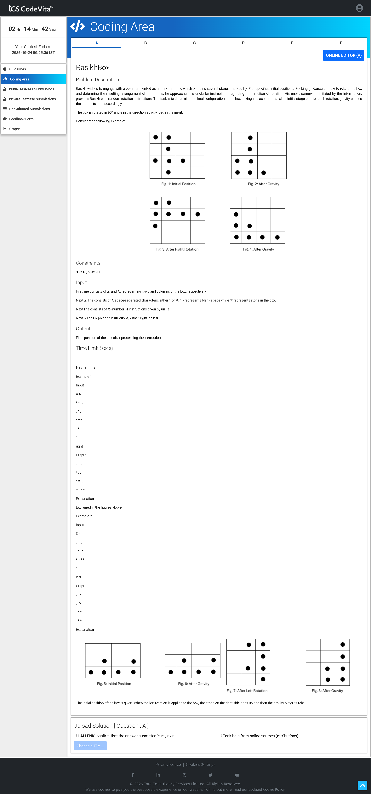

# Problem A — RasikhBox 📦

## Problem Screenshot



## 🧒 What's the Problem? (Explain Like I'm 5)

Imagine you have a box full of **stones** (`*`) and **empty spaces** (`.`), like a grid/tray.

**Gravity** always pulls the stones **down** — just like dropping marbles in a box, they fall to the bottom.

Now, your uncle gives you instructions to **tilt (rotate) the box** — either to the **left** or to the **right** — by 90°. Every time you tilt, the stones slide and fall again due to gravity.

**Your job:** After all the tilts, show what the box looks like!

### Real-Life Analogy 🍎

Think of a **sand art toy** — those flat frames filled with colored sand. When you flip it sideways, the sand flows down. Flip it the other way, sand flows again. This problem is exactly that, but with a grid of stones!

---

## 📥 Input

1. **M N** — rows and columns of the grid
2. Next **M lines** — the grid itself (`.` = empty, `*` = stone)
3. **K** — number of rotations
4. Next **K lines** — either `right` or `left`

## 📤 Output

The final grid after all rotations and gravity applications.

---

## 🧠 Approach & Logic

### Step-by-Step:

1. **Apply Gravity first** — Push all `*` stones in each column down to the bottom
2. **For each rotation instruction:**
   - **Rotate Right:** Turn the grid 90° clockwise (the left column becomes the top row)
   - **Rotate Left:** Turn the grid 90° counter-clockwise (the right column becomes the top row)
   - **Apply Gravity again** — after each rotation, stones fall down

### Optimized Python Approach (Column-Count Method):

Instead of storing the full grid, we just track **how many stones are in each column** (`ct[j]`).

- **Rotate Right:** The number of stones in each new column = how many old columns had ≥ (i+1) stones
- **Rotate Left:** Similar but counted from the other direction

This avoids actually rotating a huge grid — we just recalculate the counts!

### Visualization:

```
Initial:           After Gravity:     After Right Rotate + Gravity:
* * . .            . . . .            . . . .
. * . .     →      . . . .     →      * . . .
* * * .            . * . .            * * . .
. * . .            * * * .            * * * *
                   * * * .
```

---

## ⏱️ Complexity

| Approach | Time | Space |
|----------|------|-------|
| Python (count-based) | O(M × N + K × max(M,N)²) | O(max(M,N)) |
| Java (matrix rotation) | O(K × M × N) | O(M × N) |

---

## 💻 Solutions

- [`solution.py`](solution.py) — Python (optimized column-count approach)
- [`Solution.java`](Solution.java) — Java (direct matrix rotation approach)
