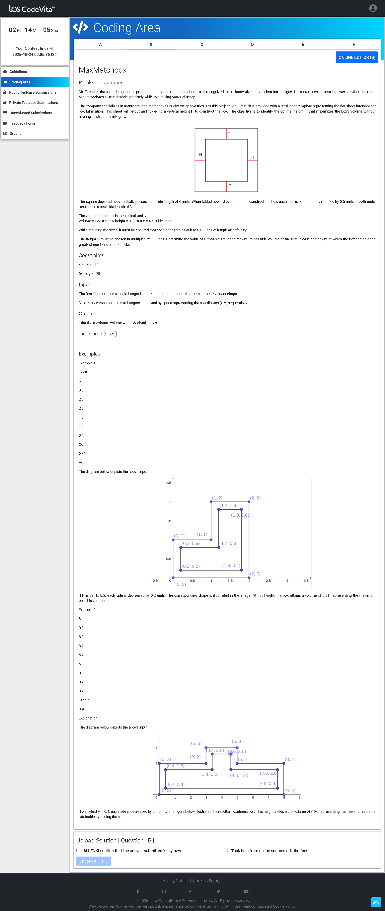

# Problem B — MaxMatchBox 📐

## Problem Screenshot



## 🧒 What's the Problem? (Explain Like I'm 5)

Imagine you have a **flat piece of cardboard** shaped like an irregular polygon (a shape with straight edges, like an L or a cross). You want to **fold the edges up** to make an **open-top box** — like folding a cardboard cutout into a tray.

When you fold up, the sides go up by height **H**, and each edge of the flat shape shrinks inward by H. The **volume** of the box = (area of the shrunken base) × H.

**Your job:** Find the value of H that gives the **maximum volume** box! H must be a multiple of 0.1.

### Real-Life Analogy 🍎

Think of making a **pizza box** from a flat piece of cardboard. If you fold up too little, the box is shallow (low volume). If you fold up too much, the base becomes tiny (also low volume). There's a **sweet spot** — the perfect height — that gives the biggest box!

---

## 📥 Input

1. **N** — number of corners of the polygon
2. Next **N lines** — (x, y) coordinates of each corner (axis-aligned rectilinear shape)

## 📤 Output

Maximum volume of the box, printed with 2 decimal places.

---

## 🧠 Approach & Logic

### Step-by-Step:

1. **Scale up by 10×** — Since H is in multiples of 0.1, we multiply all coordinates by 10 to work with integers
2. **Build a grid** — Create a 2D grid covering the polygon and mark which cells are **inside** the shape
3. **Point-in-polygon test** — Use ray-casting (count vertical edge crossings) to check if a cell center is inside
4. **Prefix sum** — Build a 2D prefix-sum array for fast area queries
5. **Try every valid height H** (as k = 1, 2, 3, ...):
   - Shrink the shape inward by k units (= H × 10)
   - Use a sliding window of size (2k+1) × (2k+1) on the prefix sum
   - Count how many positions are fully filled (the shrunk base area)
   - Volume = (count / 100) × (k / 10) (converting back from scaled coordinates)
6. **Return the maximum** volume found

### Why Prefix Sums?

Checking "is this entire square inside the polygon?" for every position would be slow. With a prefix sum, we can compute the sum of any rectangle in **O(1)** time!

```
Prefix Sum Magic:
sum(rectangle) = P[i][j] - P[i-w][j] - P[i][j-w] + P[i-w][j-w]

If this sum == w × w, the entire square is inside!
```

---

## ⏱️ Complexity

| Metric | Value |
|--------|-------|
| Time | O(N² × max_k) where N is the scaled grid size |
| Space | O(N²) for the prefix sum grid |

---

## 💻 Solutions

- [`solution.py`](solution.py) — Python
- [`Solution.java`](Solution.java) — Java
