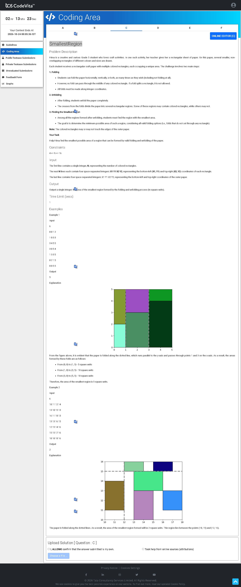

# Problem C — SmallestRegion 📄

## Problem Screenshot



## 🧒 What's the Problem? (Explain Like I'm 5)

Imagine you have a **rectangular sheet of paper** with some **colored rectangles** drawn on it. You can **fold** the paper along straight lines (horizontal or vertical) — as many times as you want.

**Rules for folding:**
- Folds must be along **integer coordinates** (whole-number lines)
- A fold **cannot cut through** any colored rectangle (it can only go between them or along the paper's edge)
- After folding, you **unfold** the paper. The creases divide the paper into smaller rectangular regions

**Your job:** Find the **smallest region** (by area) that the paper can be divided into after the best possible folding.

### Real-Life Analogy 🍎

Think of **folding a napkin** that has some stickers on it. You can fold it anywhere, but you can't fold through a sticker (it would rip!). After unfolding, the fold lines divide the napkin into rectangles. What's the smallest rectangle you can create?

---

## 📥 Input

1. **N** — number of colored rectangles
2. Next **N lines** — X1, Y1, X2, Y2 (bottom-left and top-right corners of each rectangle)
3. Last line — X1, Y1, X2, Y2 (the outer paper boundary)

## 📤 Output

Area of the smallest region (a single integer).

---

## 🧠 Approach & Logic

### Key Insight: X and Y are Independent! 💡

The smallest region is a rectangle, so its area = **smallest width × smallest height**. We can find the smallest width and smallest height **separately**!

### Step-by-Step:

1. **For the X-axis (width):**
   - Walk from left edge to right edge of the paper, one unit at a time
   - At each position, check: "Does any colored rectangle span across this line?"
   - If **no rectangle** is cut by this line → we CAN fold here! Record the gap.
   - Track the **smallest gap** between valid fold positions

2. **Do the same for the Y-axis (height)**

3. **Answer = smallest_width × smallest_height**

### Visualization:

```
Paper: x = 0 to 5
Rectangles block folds at x = 2 and x = 4

Valid fold positions: x = 0, 1, 3, 5
                     |  1  |  2  | 2 |
Gaps:                  1     2     2

Smallest width = 1
```

### Why This Works:

A fold creates a crease. If we can fold at positions x = 0, 1, 3, 5, the regions have widths 1, 2, 2. The smallest is 1. We can always choose to fold at every valid position to minimize the region size!

---

## ⏱️ Complexity

| Metric | Value |
|--------|-------|
| Time | O(N × (W + H)) where W, H are paper dimensions |
| Space | O(N) |

---

## 💻 Solutions

- [`solution.py`](solution.py) — Python
- [`Solution.java`](Solution.java) — Java
