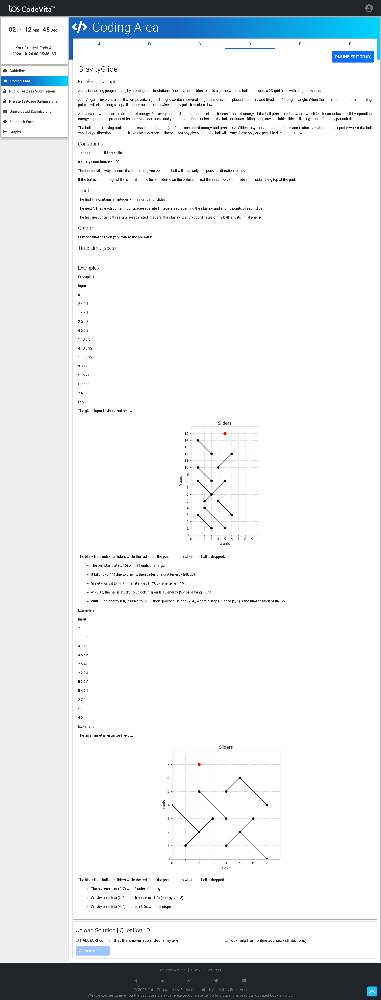

# Problem D — GravityGlide 🎮

## Problem Screenshot



## 🧒 What's the Problem? (Explain Like I'm 5)

Imagine a **ball** dropped onto a grid with **diagonal slides** (like ramps in a pinball machine). All slides are at 45° angles.

The ball has some **energy**. Here's how it moves:

1. **Fall down** — The ball drops straight down until it hits a slide (or the ground)
2. **Slide along the ramp** — It slides diagonally down the slide, using **1 energy per step**
3. **Get stuck at a junction** — If the slide goes both left and right from the ball's position (like a valley), the ball is trapped. It needs to spend `x × y` energy (its current coordinates multiplied) to **break free**
4. After breaking free, it keeps sliding. Prefer sliding **left-down** if possible, otherwise **right-down**
5. When the ball reaches the **ground (y = 0)** or runs **out of energy**, it stops

**Your job:** Print the ball's **final position** (x, y).

### Real-Life Analogy 🍎

Think of a **marble run** / pinball machine. The marble drops, hits a ramp, slides down, might get stuck in a V-shaped trap (needs energy to escape), and eventually lands at the bottom. This simulates that!

---

## 📥 Input

1. **N** — number of slides
2. Next **N lines** — x1, y1, x2, y2 (start and end points of each slide, all at 45° angles)
3. Last line — x, y, E (starting position and energy of the ball)

## 📤 Output

Final position: `x y`

---

## 🧠 Approach & Logic

### Step-by-Step Simulation:

```
┌──────────────────────────────────┐
│  1. Drop the ball straight down  │
│     Find the highest slide       │
│     directly below current (x,y) │
│                                  │
│  2. Land on the slide            │
│     Set y = slide's y at this x  │
│                                  │
│  3. Check if stuck (valley):     │
│     Both left-up and right-up    │
│     neighbors on a slide?        │
│     → Pay x*y energy to unlock   │
│                                  │
│  4. Slide downhill:              │
│     Prefer left-down (-1,-1)     │
│     Else try right-down (+1,-1)  │
│     Each step costs 1 energy     │
│                                  │
│  5. Repeat until:                │
│     - Hit ground (y=0)           │
│     - No energy left             │
│     - No slide to land on        │
└──────────────────────────────────┘
```

### Key Helper Functions:

- **`on_s(i, px, py)`** — Is point (px, py) on slide i? Uses the collinearity check: `(px-x1)(y2-y1) == (py-y1)(x2-x1)` and bounds check
- **`cg(cx, cy, dx, dy)`** — Can we go from (cx, cy) in direction (dx, dy)? Checks if both points lie on the same slide
- **Fall logic** — For each slide, compute the y-value at the ball's x. Pick the highest slide that's below the ball

---

## ⏱️ Complexity

| Metric | Value |
|--------|-------|
| Time | O(E × N) in worst case — each energy step checks all slides |
| Space | O(N) |

---

## 💻 Solutions

- [`solution.py`](solution.py) — Python
- [`Solution.java`](Solution.java) — Java
