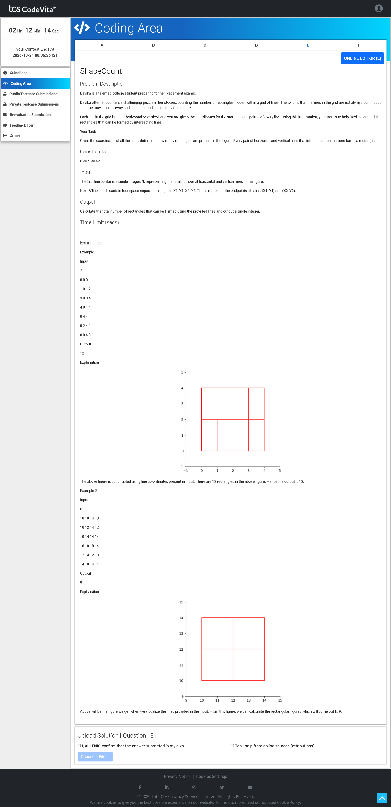

# Problem E — ShapeCount 🔢

## Problem Screenshot



## 🧒 What's the Problem? (Explain Like I'm 5)

You're given a bunch of **horizontal and vertical line segments** on a grid. Some of these lines, when combined, form the four sides of a **rectangle**.

**Your job:** Count how many **rectangles** can be formed using these lines!

### Real-Life Analogy 🍎

Imagine you drew a bunch of straight lines (only horizontal and vertical) on graph paper with a ruler. Now count every rectangle whose four sides are **completely covered** by the lines you drew. The lines don't need to be single strokes — a side can be part of a longer line, and multiple short lines can combine to cover a side.

---

## 📥 Input

1. **N** — number of line segments
2. Next **N lines** — X1, Y1, X2, Y2 (endpoints of each line)

## 📤 Output

Total number of rectangles that can be formed.

---

## 🧠 Approach & Logic

### Key Insight: Coordinate Compression 💡

The coordinates could be huge, but what matters are the **unique x and y values** where lines start/end. We compress them into small indices.

### Step-by-Step:

1. **Collect all unique x-coordinates and y-coordinates** → sort them
2. **Map each coordinate** to a small index (coordinate compression)
3. **Build bitmasks:**
   - `hm[y]` — a bitmask showing which horizontal segments exist at row y (bit k = 1 means segment from x[k] to x[k+1] exists)
   - `vm[y]` — a bitmask showing which vertical segments pass through the gap between row y and row y+1

4. **Count rectangles** using bitmask intersection:
   - For every pair of horizontal rows (top and bottom of rectangle):
     - `cm` = columns where **both** rows have horizontal coverage → `hm[a] & hm[b]`
     - `cv` = columns where vertical lines span **all the way** from row a to row b → running AND of `vm`
     - For each contiguous run of set bits in `cm`, count how many vertical lines from `cv` fall within → choose 2 of them = one rectangle side pair

### Why Bitmasks?

Bitmasks let us do **set intersection in O(1)**! Instead of checking each column one by one, we AND two bitmasks together and instantly know which columns are covered by both rows.

```
Example:
hm[row_a] = 0b11110  (segments at columns 1,2,3,4)
hm[row_b] = 0b11100  (segments at columns 2,3,4)
AND result = 0b11100  → both rows have horizontal lines at columns 2,3,4

If cv has vertical lines at columns 2,3,4:
Pick any 2 → C(3,2) = 3 rectangles!
```

---

## ⏱️ Complexity

| Approach | Time | Space |
|----------|------|-------|
| Python (bitmask) | O(H² × W) where H,W = unique y,x count | O(H + W) |
| Java (brute-force 4 loops) | O(H² × W² × max(H,W)) | O(H × W) |

---

## 💻 Solutions

- [`solution.py`](solution.py) — Python (optimized bitmask approach)
- [`Solution.java`](Solution.java) — Java (brute-force approach)
