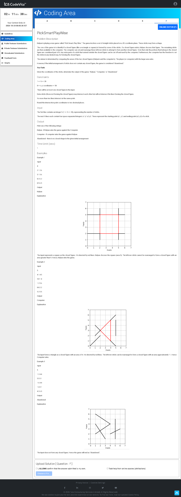

# Problem F — PickSmartPlayWise 🎲

## Problem Screenshot



## 🧒 What's the Problem? (Explain Like I'm 5)

**Kalyan** and a **Computer** are playing a game with **sticks** on a 2D plane.

1. If the sticks form a **closed shape** (like a triangle, square, or polygon), **Kalyan picks it** — he gets the area of that shape
2. The **leftover sticks** (the ones NOT part of the closed shape) go to the **Computer**
3. The Computer can **rearrange** its leftover sticks into the **best possible closed shape** — which is always a **circle** (a circle gives the maximum area for a given perimeter)
4. Whoever has the **bigger area wins**!
5. If **no closed shape** exists at all → output `"Abandoned"`

### Real-Life Analogy 🍎

Imagine you and a friend find some sticks on the ground. Some sticks form a fence around a garden (that's yours!). Your friend takes the remaining sticks and bends them into the best shape possible (a circle). Whoever enclosed more land wins!

---

## 📥 Input

1. **N** — number of sticks (line segments)
2. Next **N lines** — x1, y1, x2, y2 (endpoints of each stick)

## 📤 Output

- `"Kalyan"` — if Kalyan's polygon area ≥ Computer's circle area
- `"Computer"` — if Computer's circle area > Kalyan's polygon area
- `"Abandoned"` — if no closed shape can be formed

---

## 🧠 Approach & Logic

### Step-by-Step:

#### Phase 1: Build a Graph 🕸️

1. **Find all intersection points** between every pair of sticks (line-line intersection using cross products)
2. Each intersection or endpoint becomes a **node**
3. Each stick segment between two consecutive nodes becomes an **edge**
4. Now we have a **planar graph**

#### Phase 2: Find the Cycle (Closed Shape) 🔄

5. **Prune dead-ends** — Repeatedly remove nodes with degree ≤ 1 (leaf nodes). They can't be part of any cycle
   - This is like peeling away the "branches" of a tree until only the **loop** remains
6. If nothing's left → `"Abandoned"`
7. Otherwise, trace the remaining cycle — this is **Kalyan's polygon**

#### Phase 3: Compare Areas 📏

8. **Kalyan's area** = Polygon area using the [Shoelace Formula](https://en.wikipedia.org/wiki/Shoelace_formula):
   $$A = \frac{1}{2} \left| \sum_{i} (x_i \cdot y_{i+1} - y_i \cdot x_{i+1}) \right|$$

9. **Computer's perimeter** = Total stick length − Kalyan's polygon perimeter (leftover sticks)
10. **Computer's best area** = Area of a circle with that perimeter:
    $$A_{circle} = \frac{P^2}{4\pi}$$
    (Because perimeter = 2πr → r = P/2π → area = πr² = P²/4π)

11. Compare and print the winner!

### Why Prune Dead-Ends?

```
Before pruning:          After pruning:
    A                    
    |                    
B---C---D---E            C---D---E
    |       |                |
    F---G---H            F---G---H

Nodes A, B have degree 1 → remove them
Now C has degree 2, still part of cycle → keep!
The cycle C-D-E-H-G-F-C is Kalyan's polygon
```

---

## ⏱️ Complexity

| Metric | Value |
|--------|-------|
| Time | O(N² ) — checking all pairs for intersections |
| Space | O(N² ) — storing intersection points and graph |

---

## 💻 Solutions

- [`solution.py`](solution.py) — Python
- [`Solution.java`](Solution.java) — Java
